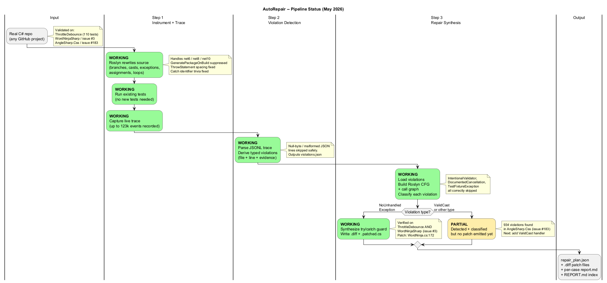

# Patching / AutoRepair

Automated C# program repair: runtime tracing + constraint solving + CFG-based
path-condition analysis.

The pipeline runs end-to-end on `ThrottleDebounce` (110-test xUnit suite) and
on real external repos mined via PRHunter - validated on `WordNinjaSharp#3`
(ArgumentOutOfRangeException, patch generated) and `AngleSharp.Css#183`
(934 ValidCast violations detected). The Instrumenter is now compatible with
net6 / net8 / net10 target frameworks.

## Pipeline Status



## Step Status

| Step | Module                                                       | State        | Description |
| :--: | :----------------------------------------------------------- | :----------- | :---------- |
| 1    | [Tracing](AutoRepair/Step1_Tracing/README.md)                | Done         | Roslyn instrumenter injects logging into any C# project; produces a structured JSONL execution trace. Compatible with net6/net8/net10; handles loop safety, exception catch, cast instrumentation, overflow and variable tracking. |
| 2    | [Constraints](AutoRepair/Step2_Constraints/README.md)        | Done         | Rule engine reads the trace and emits `violations.json` (buffer-bounds, exceptions, invalid casts, integer overflow, null deref). Malformed JSON lines are skipped safely. |
| 3    | [Repair / CFGAnalyzer](AutoRepair/Step3_Repair/README.md)    | Done (partial patch coverage) | Builds Roslyn CFG + interprocedural call graph + path conditions (by **@jpksh90**), classifies violations (`AutoPatchable`, `IntentionalValidator`, `DocumentedCancellation`, `TestFixtureException`, `UnsupportedPredicate`), and synthesises `try/catch` patches as `.diff` + `.patched.cs` for `NoUnhandledException` violations. `ValidCast` violations are detected but patch synthesis not yet implemented. |

Auxiliary tooling:

* [`PRHunter/`](PRHunter/README.md): mines GitHub for failed C# bug-fix
  attempts (rejected / reverted PRs that left an open issue) and drives the
  AutoRepair pipeline against each candidate. Used for external validation,
  not part of the core repair loop.
* [`Research/CompetitorTools/`](Research/CompetitorTools): setup notes for
  SonarQube, CodeQL, Semgrep, and InferSharp (used to compare against
  AutoRepair findings).

## Quick Start

Run the full pipeline (Step 1 -> Step 2 -> restore -> Step 3) against
ThrottleDebounce:

```powershell
powershell -ExecutionPolicy Bypass -File AutoRepair\run_all.ps1
```

Or run the steps individually:

```powershell
# 1. Instrument & trace
.\AutoRepair\Step1_Tracing\generate_trace.ps1

# 2. Analyze the trace for constraint violations
.\AutoRepair\Step2_Constraints\analyze_trace.ps1

# 3. Restore the target project to its original state
.\AutoRepair\Step1_Tracing\restore_project.ps1

# 4. Run the CFG analyzer (Step 3)
dotnet run --project AutoRepair\Step3_Repair\CFGAnalyzer\CFGAnalyzer.csproj `
  -- ThrottleDebounce\ThrottleDebounce\ThrottleDebounce.csproj
```

## Pipeline overview

```
+---------------+     +-------------------+     +--------------------+
| Step 1: Trace | --> | Step 2: Constraints| --> | Step 3: CFGAnalyzer|
| (Instrumenter)|     | (Rule engine)      |     | (Roslyn CFG+paths) |
+---------------+     +-------------------+     +--------------------+
        |                    |                          |
trace_logs.jsonl       violations.json           cfg_analyzer.log
```

Step 3 reads `violations.json` (when present), classifies each violation, and
emits side-by-side patched files plus unified diffs in
`AutoRepair/Step3_Repair/reports/patches/`. It only edits source in-place when
`run_all.ps1 -ApplyPatches` is passed.

## Repository layout

```
Patching/
|-- AutoRepair/
|   |-- Step1_Tracing/          (Instrumenter + generate_trace.ps1)
|   |-- Step2_Constraints/      (Constraints analyzer + analyze_trace.ps1)
|   |-- Step3_Repair/           (CFGAnalyzer + reports/cfg_analyzer.log)
|   |   `-- CFGAnalyzer/        (Step 3 implementation, by @jpksh90)
|   `-- run_all.ps1             (Orchestrator: Step1 -> 2 -> restore -> 3)
|
|-- ThrottleDebounce/           (Primary integration target; 110 xUnit tests)
|-- TargetApp/                  (Tiny demo app with deliberate bugs)
|-- MicrosoftBugDemo/           (dotnet/runtime#120561 reproduction)
|
|-- PRHunter/                   (GitHub miner + e2e demo orchestrator)
|-- Research/
|   `-- CompetitorTools/        (SonarQube, CodeQL, Semgrep, InferSharp setup)
|
`-- Patching.sln
```

## Targets

| Target                                | Role                       | Notes |
| :------------------------------------ | :------------------------- | :---- |
| `ThrottleDebounce`                    | Primary integration target | Real rate-limiting library, 110-test xUnit suite. Pipeline instruments it, runs the tests, derives violations, then runs the CFG analyzer and emits patches. |
| `PRHunter/e2e/cases/01` - `WordNinjaSharp#3` | External validation | ArgumentOutOfRangeException. 123,947 trace events, 2 violations, 1 AutoPatchable patch generated (`WordNinja.cs:172` dictionary-load guard). |
| `PRHunter/e2e/cases/02` - `AngleSharp.Css#183` | External validation | 934 ValidCast violations detected at `DeclarationInfo.cs:30`. Detection confirmed; patch synthesis for ValidCast is the next work item. |
| `TargetApp`                           | Smoke test                 | Tiny app with deliberate buffer overflows / casts / overflows; used during early development of the Instrumenter. |
| `MicrosoftBugDemo/`                   | Real-world repro           | Reproduces dotnet/runtime#120561 (NRE in `ReflectionXmlSerializationWriter`). |
| `AutoRepair/Step3_Repair/CFGAnalyzer/samples/` | CFG analyzer fixtures | Small projects validating the Step 3 call-graph resolvers. |

## Prerequisites

* [.NET 10 SDK](https://dotnet.microsoft.com/download) (preview).
* Windows PowerShell 5.1+ (ships with Windows). PowerShell 7 also works.
* Python 3.10+ if you want to use PRHunter.
